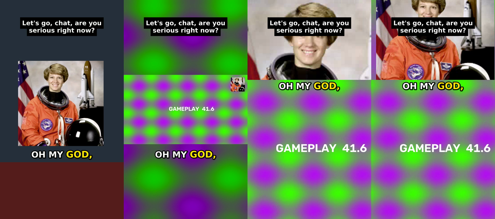

# AI-Clipper · Clip Studio

Creates clips of streams and videos with an AI that runs on your own system.

Lokale App, die lange Videos (Stream-VODs, Podcasts, Interviews) automatisch in
fertige 9:16-Clips mit Untertiteln verwandelt – für YouTube Shorts, Instagram Reels und TikTok.
Alles läuft auf deinem Rechner, kostenlos. Nur die optionale KI-Auswahl nutzt die Claude-API.



## Herunterladen

Auf <https://github.com/Ege2905/AI-Clipper> → grüner Button **Code** → **Download ZIP**,
entpacken (z.B. nach `Videos\clip-studio`).

## Updates

In der App: ⚙ Einstellungen → **Updates** → „Nach Updates suchen“ → „Jetzt installieren“.
Die App lädt die neue Version von GitHub, startet neu, und Projekte, Clips und Einstellungen
bleiben erhalten. Steht ein Update bereit, erscheint oben auch „⬆ Update verfügbar“.

## Starten

**Windows:** Doppelklick auf `start_windows.bat`
**Mac:** Rechtsklick auf `start_mac.command` → Öffnen (beim ersten Mal, wegen Gatekeeper)

Beim ersten Start wird alles automatisch eingerichtet (Python-Pakete, ffmpeg) – das dauert
ein paar Minuten. Danach öffnet sich Clip Studio im Browser (http://127.0.0.1:7860).
Das schwarze Fenster offen lassen, solange du die App benutzt.

Voraussetzung: **Python 3.10+** von <https://www.python.org/downloads/>
(Windows: bei der Installation „Add Python to PATH“ anhaken). Auf dem Mac zusätzlich
[Homebrew](https://brew.sh) für ffmpeg.

## So benutzt du es

1. **＋ Neues Projekt** → Twitch-/YouTube-/Kick-Link einfügen oder Videodatei reinziehen
2. Art wählen: *Gaming-Stream*, *Just Chatting*, *Podcast* (setzt passende Einstellungen)
3. **▶ Clips erstellen** – Fortschritt wird live angezeigt, Clips erscheinen nacheinander
4. Clips ansehen, Caption-Text anpassen (speichert automatisch), **📋 Text kopieren**,
   **⬇ Download**, und abhaken wo du gepostet hast (YouTube / Instagram / TikTok)
5. Nicht zufrieden? **✂️ Neu schneiden** mit anderen Einstellungen – Download und
   Transkript werden wiederverwendet, geht also schnell

Tipps:
- Bei langen Streams unter *Erweiterte Einstellungen* einen **Abschnitt** angeben (z.B. `1:00:00-2:00:00`).
- Für Gaming-Streams die **Facecam-Position** einmal eintragen (x,y,breite,höhe als Anteil
  des Bildes, z.B. `0.80,0.02,0.18,0.25` = oben rechts) – dann sitzt der Split immer perfekt.
- **KI-Auswahl** (⚙ Einstellungen → API-Key von console.anthropic.com): deutlich bessere
  Momente bei Podcasts, plus Titel, Caption und Hashtags. Kostet je nach Länge ein paar Cent.
- **Lokale KI statt API (kostenlos, offline):** [Ollama](https://ollama.com/download) installieren
  und starten → in Clip Studio ⚙ Einstellungen → „Lokal (Ollama)“ → **Modell herunterladen**.
  Empfehlung: `qwen3:8b` (ca. 5 GB, braucht ~8 GB Grafikspeicher oder RAM), bei schwachem PC
  `qwen3:4b`, bei starker Grafikkarte `qwen3:14b`. Läuft ohne Grafikkarte auch, nur langsamer.
  Lange Streams werden in Stücken analysiert. Liefert das Modell zu wenige Momente,
  füllt die App automatisch mit der normalen Auswahl auf.
- Die Clips liegen im Ordner `jobs/<projekt>/clips/` (Button **📂 Ordner öffnen**).

---

# Kommandozeile (für Fortgeschrittene)

Die App benutzt intern `clipper.py`, das du auch direkt aufrufen kannst:

## autoclipper CLI

Turns long videos (stream VODs, podcasts, interviews) into vertical 9:16 clips with
word-by-word captions, ready for YouTube Shorts, Instagram Reels and TikTok.

```
VOD / podcast ──► yt-dlp ──► Whisper transcript ──► pick best moments ──► 9:16 reframe ──► captions ──► MP4s
                                                    (heuristic or Claude)   (face track /
                                                                             facecam split /
                                                                             blurred fit)
```

## 1. Install (once)

1. **Python 3.10+**: <https://www.python.org/downloads/> (Windows: tick "Add to PATH")
2. **ffmpeg**
   - Windows: `winget install Gyan.FFmpeg`
   - macOS: `brew install ffmpeg`
3. In this folder (or just run the start script once):
   ```
   python -m venv venv
   venv\Scripts\activate          (Windows)   |   source venv/bin/activate   (macOS/Linux)
   pip install -r requirements.txt
   ```

The first run downloads the Whisper speech model (~500 MB for `small`).
If you have an NVIDIA GPU, transcription is much faster. On CPU, expect roughly
real-time / 3 with `small`, so try `--section` on long streams first.

## 2. Use

```bash
# 5 clips from a Twitch VOD (only the 2nd hour)
python clipper.py "https://www.twitch.tv/videos/123456789" --section 1:00:00-2:00:00

# Podcast file, 8 clips, 25-55 s each, German
python clipper.py podcast.mp4 -n 8 --min 25 --max 55 --language de

# Let Claude choose the moments and write titles/captions/hashtags
set ANTHROPIC_API_KEY=sk-ant-...        (Windows; macOS: export ANTHROPIC_API_KEY=...)
python clipper.py "<url>" --ai

# Just see which moments it would pick, without rendering
python clipper.py "<url>" --dry-run
```

Output in `clips/`:

| file | what |
|---|---|
| `01_title.mp4` | 1080×1920 clip, H.264/AAC, ready to upload |
| `01_title.txt` | title + caption + hashtags to paste when posting |
| `clips.json` | timestamps, scores, layout per clip |
| `.work/` | cached download, transcript, loudness; delete to start fresh |

Re-running on the same `--out` folder reuses the download and transcript, so trying other
settings is fast.

### Layouts

| `--layout` | best for | what it does |
|---|---|---|
| `auto` (default) | anything | picks one of the three below by detecting faces |
| `track` | podcasts, IRL/just-chatting | crops 9:16 and smoothly follows the speaker's face |
| `split` | gaming streams | facecam on top, gameplay below |
| `fit` | no faces, screen content | full frame centred over a blurred background |

For gaming streams, give the facecam position once and it is always right:
`--facecam 0.80,0.02,0.18,0.25` = x, y, width, height as fractions of the frame
(this example is the top-right corner). Take a screenshot of the stream and measure it.

### Other options

`-n` clip count · `--min/--max` length in seconds · `--whisper-model tiny|base|small|medium|large-v3`
· `--font "Montserrat Black"` (any installed font) · `--words-per-line 2` · `--no-upper`
· `--no-title` · `--hashtags "#twitch #fyp"` · `--crf 18` (higher quality) ·
`--ai-provider ollama --ai-model qwen3:8b` (local model via Ollama, free) or `--ai-provider anthropic --ai-model <id>` (Claude API; check docs.claude.com for current model ids).

## 3. How moment selection works

**Heuristic mode (free, offline)** scores every 20–60 s window that starts and ends on a
sentence boundary by:
- audio loudness peaks relative to the rest of the stream (shouting, laughing, hype)
- speech density (fast talk is more engaging than dead air)
- reaction words (EN + DE: "no way", "insane", "krass", "digga", ...)
- whether it opens with a hook (question / "nobody tells you...") and ends cleanly
- penalty for long silences

Good for streams with clear reactions. For podcasts, where the best moments are *what* is
said rather than how loud, `--ai` is noticeably better.

**AI mode** sends the timestamped transcript to Claude, which returns moments plus title,
caption and hashtags. A 3-hour stream costs a few cents to a dollar depending on the model.

Always watch your clips before posting. Automation finds candidates; you are the editor.

## 4. Posting workflow

1. Run the clipper, watch the results, delete the weak ones.
2. Upload each MP4 natively to each platform, with the text from the `.txt` file.
   Native uploads perform better than cross-posted videos with other apps' watermarks.
3. Best practice: 1–3 posts per day per platform, consistent niche (one streamer or topic per account).
4. Automating uploads later: YouTube Data API works, but uploads from unverified API projects
   stay *private* until Google audits the app. TikTok/Instagram APIs also need app review.
   For a handful of clips a day, a scheduler (Buffer, Metricool, etc.) or manual upload is simpler.

## 5. Rules: stay on the right side

- **Only clip content you have permission to use**: your own videos, creators who allow
  clipping, or paid clipping campaigns (e.g. Whop Content Rewards). Clipping movies/TV or
  random creators gets Content ID claims, strikes, and banned accounts.
- **Add value**: captions, a hook title and tight editing. YouTube's reused/"inauthentic"
  content policy demonetises channels that just re-upload others' content unchanged.
- Credit the creator in the caption (campaigns usually require specific tags).
- Don't remove other creators' watermarks, and don't buy views. Campaign platforms detect
  bot traffic and won't pay.
